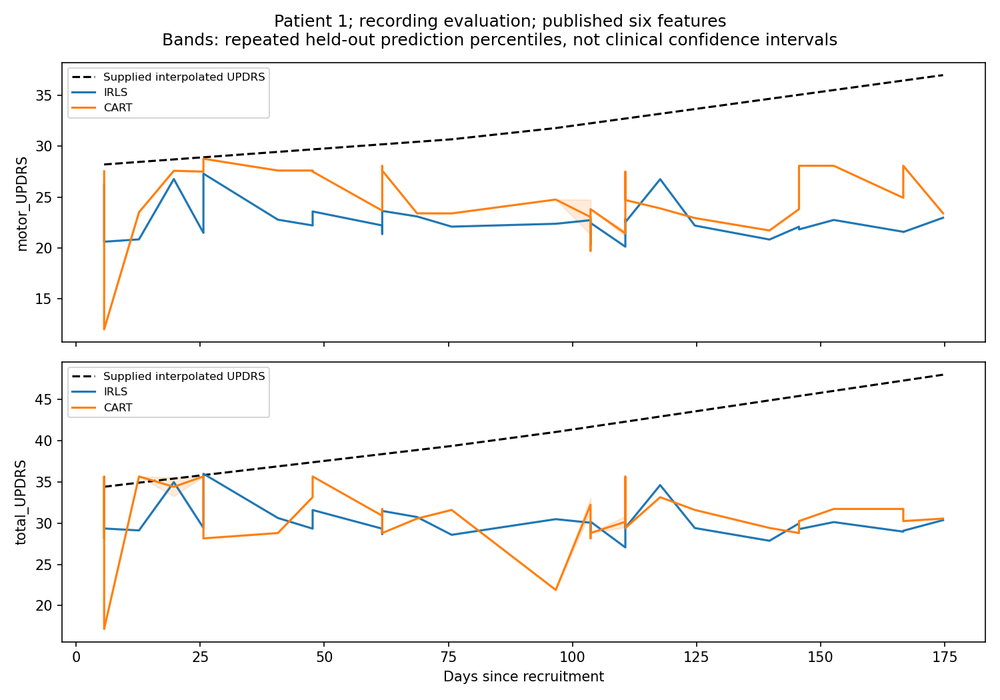

# Telemonitoring paper: reproduction-style experiment

Data: `/Users/ayushikaushal/Desktop/college/2nd year/3rd year/machine learning/parkinsons-linear-regression/parkinsons-final/PARKINSONS_ML/DATA/raw/UCI_Oxford_Voice/telemonitoring/parkinsons_updrs.data`; recordings: 5875; patients: 42.
Dataset SHA-256: `f2c7d5025dec4e92e7feae367a5f7ccf58789a10ac6b54bdf15976c599f9dd39`.
Seed: 42; recording repetitions: 2; patient folds: 7; inner splits: 3; linear-model scaling: none.

## Explicit choices and limits

- Public UCI release: 5,875 recordings; paper: 5,923. Exact identity is unresolved.
- No-intercept LS, IRLS and LASSO. IRLS counts initial LS as iteration one of 100.
- Scaling defaults to none; maxabs is an optional, training-only alternative. The paper's plot normalization does not establish its regression scaling recipe.
- LASSO alpha/alpha_max grid: `[1.0, 0.3981071705534972, 0.15848931924611134, 0.0630957344480193, 0.025118864315095794, 0.01, 0.003981071705534969, 0.0015848931924611126, 0.000630957344480193, 0.00025118864315095795, 0.0001, 3.9810717055349695e-05, 1.5848931924611107e-05, 6.30957344480193e-06, 2.511886431509577e-06, 1e-06]`.
- Sklearn CART ccp_alpha grid: `[0.0, 0.01, 0.03, 0.1, 0.3, 1.0, 3.0]`; min_samples_leaf=1. This is not a claimed parameter-equivalent MATLAB implementation.
- Inner selection: repeated 80/20 recording splits or grouped patient folds. Outer test labels never choose subsets, alpha or pruning.
- LASSO-derived subsets are ranked using CART training RSS/reference_variance plus 2D or log(n)D. Reference variance is full-feature LS training MSE, shared across candidates. This explicit choice resolves an underspecified paper detail.
- AIC/BIC columns describe CART-based subset selection, not each row's regression model.
- Recording-level splitting can share patients across train/test. Patient-level splitting cannot.
- Metrics are recording-weighted. Pooled scores use individual held-out predictions, not averaged prediction ensembles. Fold/repetition SD is not a clinical confidence interval.
- Tracking CSV retains only paper6 IRLS/CART predictions, aggregated per recording. Percentile bands represent repeated-prediction variation; patient-wise rows have one prediction.
- Targets are already interpolated. Tracking them is not future progression forecasting.
- Other UPDRS target, patient ID, age, sex and test_time are never predictors.

## Results

| protocol | target | feature_set | model | mean_test_mae | std_test_mae | pooled_test_mae | pooled_test_r2 |
| --- | --- | --- | --- | --- | --- | --- | --- |
| recording | motor_UPDRS | none | Training mean | 6.9023 | 0.2299 | 6.9023 | -0.0003 |
| recording | motor_UPDRS | all16 | LS | 6.6572 | 0.2065 | 6.6572 | 0.0458 |
| recording | motor_UPDRS | all16 | IRLS | 6.6055 | 0.1934 | 6.6055 | 0.0494 |
| recording | motor_UPDRS | all16 | LASSO | 6.7168 | 0.1659 | 6.7168 | 0.0229 |
| recording | motor_UPDRS | all16 | CART | 5.6131 | 0.0028 | 5.6131 | 0.1609 |
| recording | motor_UPDRS | paper6 | LS | 6.8001 | 0.1892 | 6.8001 | 0.0118 |
| recording | motor_UPDRS | paper6 | IRLS | 6.7719 | 0.1735 | 6.7719 | 0.0059 |
| recording | motor_UPDRS | paper6 | LASSO | 6.8477 | 0.1866 | 6.8477 | -0.0019 |
| recording | motor_UPDRS | paper6 | CART | 5.8732 | 0.0955 | 5.8732 | 0.1233 |
| recording | motor_UPDRS | lasso_aic | LS | 6.6572 | 0.2065 | 6.6572 | 0.0458 |
| recording | motor_UPDRS | lasso_aic | IRLS | 6.6055 | 0.1934 | 6.6055 | 0.0494 |
| recording | motor_UPDRS | lasso_aic | LASSO | 6.7168 | 0.1659 | 6.7168 | 0.0229 |
| recording | motor_UPDRS | lasso_aic | CART | 5.6131 | 0.0028 | 5.6131 | 0.1609 |
| recording | motor_UPDRS | lasso_bic | LS | 6.6572 | 0.2065 | 6.6572 | 0.0458 |
| recording | motor_UPDRS | lasso_bic | IRLS | 6.6055 | 0.1934 | 6.6055 | 0.0494 |
| recording | motor_UPDRS | lasso_bic | LASSO | 6.7168 | 0.1659 | 6.7168 | 0.0229 |
| recording | motor_UPDRS | lasso_bic | CART | 5.6131 | 0.0028 | 5.6131 | 0.1609 |
| recording | total_UPDRS | none | Training mean | 8.5243 | 0.1742 | 8.5243 | -0.001 |
| recording | total_UPDRS | all16 | LS | 8.3861 | 0.1906 | 8.3861 | 0.0272 |
| recording | total_UPDRS | all16 | IRLS | 8.2975 | 0.2184 | 8.2975 | 0.0147 |
| recording | total_UPDRS | all16 | LASSO | 8.4457 | 0.1567 | 8.4457 | 0.014 |
| recording | total_UPDRS | all16 | CART | 7.4271 | 0.199 | 7.4271 | 0.1797 |
| recording | total_UPDRS | paper6 | LS | 8.5551 | 0.0582 | 8.5551 | -0.0098 |
| recording | total_UPDRS | paper6 | IRLS | 8.4907 | 0.1065 | 8.4907 | -0.0194 |
| recording | total_UPDRS | paper6 | LASSO | 8.5787 | 0.081 | 8.5787 | -0.0152 |
| recording | total_UPDRS | paper6 | CART | 7.5109 | 0.3265 | 7.5109 | 0.1891 |
| recording | total_UPDRS | lasso_aic | LS | 8.3861 | 0.1906 | 8.3861 | 0.0272 |
| recording | total_UPDRS | lasso_aic | IRLS | 8.2975 | 0.2184 | 8.2975 | 0.0147 |
| recording | total_UPDRS | lasso_aic | LASSO | 8.4457 | 0.1567 | 8.4457 | 0.014 |
| recording | total_UPDRS | lasso_aic | CART | 7.4271 | 0.199 | 7.4271 | 0.1797 |
| recording | total_UPDRS | lasso_bic | LS | 8.3861 | 0.1906 | 8.3861 | 0.0272 |
| recording | total_UPDRS | lasso_bic | IRLS | 8.2975 | 0.2184 | 8.2975 | 0.0147 |
| recording | total_UPDRS | lasso_bic | LASSO | 8.4457 | 0.1567 | 8.4457 | 0.014 |
| recording | total_UPDRS | lasso_bic | CART | 7.4271 | 0.199 | 7.4271 | 0.1797 |
| patient | motor_UPDRS | none | Training mean | 6.9878 | 1.5283 | 6.9904 | -0.013 |
| patient | motor_UPDRS | all16 | LS | 7.167 | 1.8609 | 7.1735 | -0.0985 |
| patient | motor_UPDRS | all16 | IRLS | 7.2172 | 1.8999 | 7.2237 | -0.1329 |
| patient | motor_UPDRS | all16 | LASSO | 7.2648 | 1.8024 | 7.269 | -0.1147 |
| patient | motor_UPDRS | all16 | CART | 7.0989 | 1.4797 | 7.1022 | -0.0706 |
| patient | motor_UPDRS | paper6 | LS | 7.2437 | 1.5712 | 7.249 | -0.0921 |
| patient | motor_UPDRS | paper6 | IRLS | 7.3322 | 1.5935 | 7.3371 | -0.1233 |
| patient | motor_UPDRS | paper6 | LASSO | 7.2608 | 1.5333 | 7.2661 | -0.096 |
| patient | motor_UPDRS | paper6 | CART | 7.1637 | 1.5244 | 7.166 | -0.0856 |
| patient | motor_UPDRS | lasso_aic | LS | 7.4116 | 2.1601 | 7.4143 | -0.2454 |
| patient | motor_UPDRS | lasso_aic | IRLS | 7.483 | 2.2589 | 7.4864 | -0.2718 |
| patient | motor_UPDRS | lasso_aic | LASSO | 7.4965 | 2.0789 | 7.4991 | -0.2546 |
| patient | motor_UPDRS | lasso_aic | CART | 7.2032 | 1.5819 | 7.2069 | -0.1318 |
| patient | motor_UPDRS | lasso_bic | LS | 7.4116 | 2.1601 | 7.4143 | -0.2454 |
| patient | motor_UPDRS | lasso_bic | IRLS | 7.483 | 2.2589 | 7.4864 | -0.2718 |
| patient | motor_UPDRS | lasso_bic | LASSO | 7.4965 | 2.0789 | 7.4991 | -0.2546 |
| patient | motor_UPDRS | lasso_bic | CART | 7.2032 | 1.5819 | 7.2069 | -0.1318 |
| patient | total_UPDRS | none | Training mean | 8.7266 | 2.8149 | 8.7382 | -0.0205 |
| patient | total_UPDRS | all16 | LS | 9.1238 | 3.2538 | 9.142 | -0.1226 |
| patient | total_UPDRS | all16 | IRLS | 9.0871 | 3.3018 | 9.1052 | -0.1302 |
| patient | total_UPDRS | all16 | LASSO | 8.9849 | 3.2916 | 9.0002 | -0.1052 |
| patient | total_UPDRS | all16 | CART | 9.2176 | 2.7604 | 9.2308 | -0.1169 |
| patient | total_UPDRS | paper6 | LS | 9.2313 | 3.0662 | 9.2484 | -0.1301 |
| patient | total_UPDRS | paper6 | IRLS | 9.2744 | 3.0885 | 9.2907 | -0.1484 |
| patient | total_UPDRS | paper6 | LASSO | 9.1679 | 2.9663 | 9.1841 | -0.1138 |
| patient | total_UPDRS | paper6 | CART | 9.2744 | 2.678 | 9.2873 | -0.1244 |
| patient | total_UPDRS | lasso_aic | LS | 9.0412 | 3.2215 | 9.0591 | -0.0948 |
| patient | total_UPDRS | lasso_aic | IRLS | 9.0035 | 3.2207 | 9.0211 | -0.1005 |
| patient | total_UPDRS | lasso_aic | LASSO | 9.0415 | 3.338 | 9.0574 | -0.1162 |
| patient | total_UPDRS | lasso_aic | CART | 9.2287 | 2.9851 | 9.2438 | -0.1522 |
| patient | total_UPDRS | lasso_bic | LS | 9.0412 | 3.2215 | 9.0591 | -0.0948 |
| patient | total_UPDRS | lasso_bic | IRLS | 9.0035 | 3.2207 | 9.0211 | -0.1005 |
| patient | total_UPDRS | lasso_bic | LASSO | 9.0415 | 3.338 | 9.0574 | -0.1162 |
| patient | total_UPDRS | lasso_bic | CART | 9.2287 | 2.9851 | 9.2438 | -0.1522 |

Paper selected-six CART reference MAE: motor 5.95, total 7.52. These are historical reference values, not scores computed by this script.
